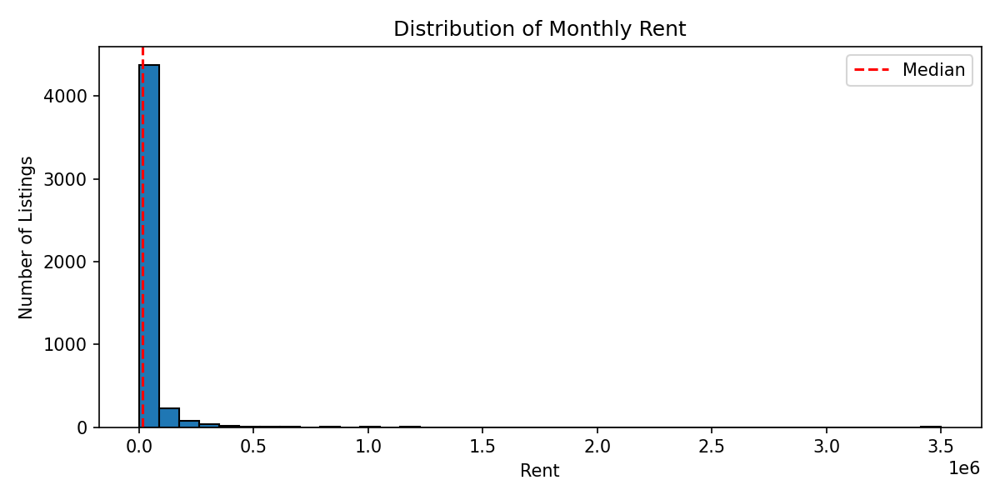
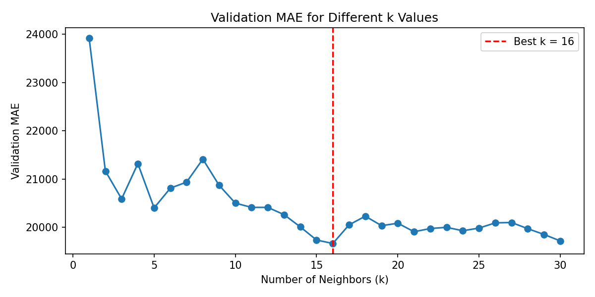
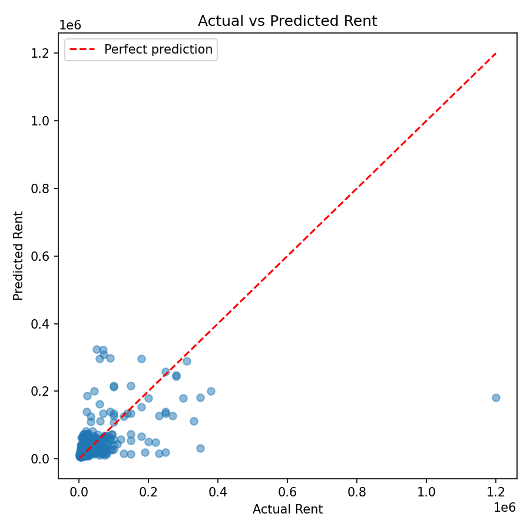

# House Rent Prediction with KNN

The first project in the University of Tehran Machine Learning course explores K-Nearest Neighbors regression by predicting monthly house rent from a small set of numerical property features.

The KNN algorithm is implemented from scratch with NumPy. Scikit-learn is used only for splitting the data and standardizing the features.

## Learning goals

- Understand the roles of training, validation, and test sets.
- Prevent data leakage while scaling features.
- Implement Euclidean-distance KNN regression from scratch.
- Study how the value of `k` changes validation error.
- Compare the final model with a simple mean baseline.
- Inspect the model's largest prediction errors and limitations.

## Dataset

The project uses the [House Rent Prediction Dataset](https://www.kaggle.com/datasets/iamsouravbanerjee/house-rent-prediction-dataset) published on Kaggle by Sourav Banerjee.

| Property | Value |
|---|---:|
| Rows | 4,746 |
| Columns | 12 |
| Target | `Rent` |
| Initial features | `BHK`, `Size`, `Bathroom` |
| Missing values | 0 |

The target represents monthly rent in Indian rupees. The original dataset terms and attribution remain available on Kaggle.

## Method

1. Inspect the dataset and target distribution.
2. Select three numerical input features.
3. Split the data into 70% training, 15% validation, and 15% test sets with `random_state=42`.
4. Fit `StandardScaler` only on the training data.
5. Build a mean-prediction baseline.
6. Implement KNN regression from scratch using Euclidean distance.
7. Evaluate `k` values from 1 to 30 on the validation set.
8. Refit on the combined training and validation data using the selected `k`.
9. Evaluate the selected uniform KNN model on the held-out test set and analyze the largest errors.
10. Compare uniform averaging with inverse-distance-weighted averaging.

## Results

| Metric | Result |
|---|---:|
| Best `k` | 16 |
| Best validation MAE | 19,664 INR |
| Mean baseline test MAE | 30,583 INR |
| Final KNN test MAE | 20,833 INR |
| Improvement over baseline | 31.9% |
| Median absolute test error | 8,362 INR |
| Best weighted `k` | 19 |
| Weighted KNN validation MAE | 19,539 INR |
| Weighted KNN test MAE | 22,695 INR |
| Weighted change vs. uniform KNN | 8.9% worse |

The model improves substantially over the mean baseline, but the error analysis shows that three numerical features cannot explain the full variation in rent. Location, city, furnishing status, and area type are important candidates for future experiments.

Distance weighting slightly lowers validation MAE, but it does not generalize better to the test set. Its test MAE is 8.9% higher than uniform KNN, so the original uniform-average model remains the better final model in this experiment.

## Visual results

### Rent distribution



The target is strongly right-skewed: most listings have moderate rent, while a small number of expensive properties create a long tail.

### Choosing the number of neighbors



The validation experiment selects `k=16`. Small values of `k` react strongly to individual samples, while larger values produce smoother predictions.

### Actual versus predicted rent



Predictions follow the general direction of the target but underestimate several high-rent properties. This is consistent with the missing location and property-condition information.

## Project structure

```text
01-house-rent-knn/
├── data/
│   ├── processed/
│   └── raw/House_Rent_Dataset.csv
├── images/
│   ├── actual_vs_predicted_rent.png
│   ├── k_vs_validation_mae.png
│   └── rent_distribution.png
├── notebooks/01_data_exploration.ipynb
├── .gitignore
├── README.md
└── requirements.txt
```

## Run the notebook

From the project folder on Windows PowerShell:

```powershell
python -m venv .venv
.\.venv\Scripts\Activate.ps1
python -m pip install -r requirements.txt
jupyter lab notebooks/01_data_exploration.ipynb
```

Run the cells from top to bottom. The notebook regenerates all figures in the `images` folder.

## Main limitation

This project intentionally keeps the first model simple. It demonstrates the complete machine-learning workflow, but it is not a production rent estimator. A stronger follow-up experiment should encode categorical variables, compare feature sets using validation data, and keep the test set untouched until the final evaluation.

